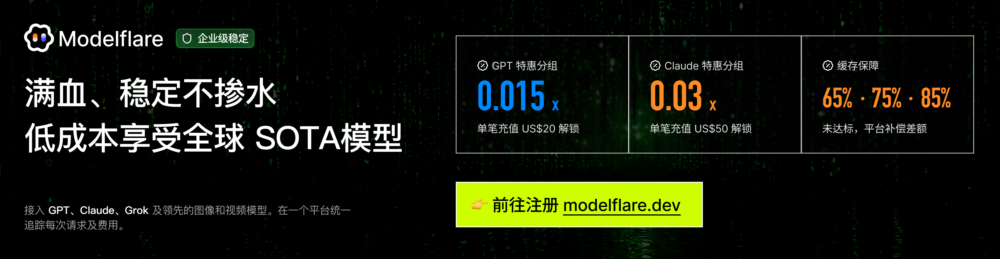

<div align="center">

# 📈 AI-Powered Stock Analysis System

[](https://github.com/ZhuLinsen/daily_stock_analysis/stargazers)
[](https://arxiv.org/abs/2608.26990)
[](https://github.com/ZhuLinsen/daily_stock_analysis/actions/workflows/ci.yml)
[](https://opensource.org/licenses/MIT)
[](https://www.python.org/downloads/)
[](https://github.com/features/actions)
[](https://hub.docker.com/r/zhulinsen/daily_stock_analysis)

<p align="center">
  &nbsp;<a href="https://hellogithub.com/repository/ZhuLinsen/daily_stock_analysis" target="_blank"></a>
</p>

> 🤖 An AI-powered intelligent watchlist analysis system for mainland Chinese, Hong Kong, US, Japanese, South Korean, and Taiwanese stocks. It automatically analyzes selected stocks every day and sends a “Decision Dashboard” to WeCom, Feishu, Telegram, Discord, Slack, or email.

[**Product Preview**](#️-product-preview) · [**Features**](#-features) · [**Quick Start**](#-quick-start) · [**Notification Examples**](#-notification-examples) · [**Documentation Center**](docs/INDEX.md) · [**Complete Guide**](docs/full-guide.md)

[Simplified Chinese](../README.md) | English | [Traditional Chinese](docs/README_CHT.md)

</div>

<details open>
<summary><strong>💖 Sponsors</strong></summary>
<hr>
<div align="center">
  <p><a href="https://modelflare.dev/sign-up?utm_source=github&amp;utm_campaign=daily_stock_analysis"></a><br>Thanks to <strong>Modelflare</strong> for sponsoring this project! Operated by US-based Havenbyte LLC, it provides stable, low-cost access to GPT, Claude, Gemini, Grok, and more than 40 image and video models. Selected OpenAI groups provide <strong>65% / 75% / 85% daily cache-hit-rate guarantees</strong>. A single top-up of <strong>US$20 unlocks GPT at 0.015x</strong>, while <strong>US$50 unlocks Claude at 0.03x</strong>. <a href="https://modelflare.dev/sign-up?utm_source=github&amp;utm_campaign=daily_stock_analysis">Register through the dedicated link</a>.</p>
  <hr>
  <p><a href="https://serpapi.com/github-daily-stock-analysis" target="_blank"></a></p>
</div>
</details>

## 🖥️ Product Preview

<p align="center">
  
</p>

## ✨ Features

| Capability | Coverage |
|---|---|
| AI decision reports | Key conclusions, scores, trends, entry and exit levels, risk alerts, catalysts, and action checklists |
| Multi-market data aggregation | Covers mainland Chinese, Hong Kong, US, Japanese, South Korean, and Taiwanese stocks, as well as ETFs. Supports quotes, candlestick data, technical indicators, news, announcements, fundamentals, and supporting report data. See [Market Support Boundaries](docs/market-support.md) for market-specific data sources and limitations. |
| Web and desktop workspace | Manual analysis, task progress, historical reports, full Markdown output, backtesting, holdings, configuration management, and light/dark themes |
| Agent-based strategy queries | Multi-turn follow-up questions with 15 built-in strategies covering moving averages, Chan theory, Elliott Wave theory, trends, market themes, events, growth, and expectations across Web, Bot, and API interfaces |
| Smart import and autocomplete | Import from images, CSV/Excel, or the clipboard. Autocomplete stock symbols, names, Pinyin, and aliases. |
| Automation and notifications | GitHub Actions, Docker, local scheduled tasks, FastAPI service, and notifications through WeCom, Feishu, Telegram, Discord, Slack, and email |

> For feature details, field contracts, fundamental-data P0 timeout semantics, trading discipline, data-source priority, and Web/API behavior, see the [Complete Configuration and Deployment Guide](docs/full-guide.md).

### Technology Stack and Data Sources

| Type | Supported options |
|---|---|
| AI models | [Modelflare](https://modelflare.dev/sign-up?utm_source=github&utm_campaign=daily_stock_analysis), [AIHubMix](https://inferera.com/?aff=CfMq), Gemini, OpenAI-compatible providers, DeepSeek, Qwen, Claude, local Ollama models, and others |
| Market data | AkShare, Tushare, Pytdx, Baostock, YFinance, Longbridge |
| News search | [Anspire](https://open.anspire.cn/dsa?share_code=QFBC0FYC), [SerpAPI](https://serpapi.com/github-daily-stock-analysis), [Tavily](https://tavily.com/), [Bocha](https://open.bocha.cn/), [Brave](https://brave.com/search/api/), [MiniMax](https://platform.minimaxi.com/), SearXNG |
| Social sentiment | [Stock Sentiment API](https://api.adanos.org/docs) for Reddit, X, and Polymarket. US stocks only; optional. |

> Free market-data sources such as AkShare, Baostock, and YFinance are included by default and can run without configuration. Their stability is not guaranteed because upstream rate limits, interface changes, and network conditions may affect them. For long-running schedules, batch analysis, or more stable market data, configure token-based sources such as Tushare or Longbridge. See [Data Source Configuration](docs/full-guide.md#数据源配置) for supported markets, GitHub Actions mappings, and fallback rules.

## 🚀 Quick Start

### Option 1: [GitHub Actions, recommended](https://www.bilibili.com/video/BV11FEb66EXG/)

> Deploy without a server or hosting cost.

#### 1. Fork this repository

Click the `Fork` button in the upper-right corner. You can also support the project by giving it a Star ⭐.

#### 2. Configure secrets

Go to `Settings` → `Secrets and variables` → `Actions` → `New repository secret`.

**AI model configuration, at least one required**

Choose one model provider and enter its API key. For multiple models, image recognition, local models, or advanced routing, see the [LLM Configuration Guide](docs/LLM_CONFIG_GUIDE.md).

| Secret name | Description | Required |
|---|---|:---:|
| `MODELFLARE_KEY` | [Modelflare](https://modelflare.dev/sign-up?utm_source=github&utm_campaign=daily_stock_analysis) API key for low-cost access to popular global models | **Recommended** |
| `AIHUBMIX_KEY` | [AIHubMix](https://inferera.com/?aff=CfMq) API key. Switch between the full range of models with one key. This project is eligible for a 10% discount. | **Recommended** |
| `GEMINI_API_KEY` | Google Gemini API key | Optional |
| `ANTHROPIC_API_KEY` | Anthropic Claude API key | Optional |
| `OPENAI_API_KEY` | OpenAI-compatible API key, including DeepSeek and Qwen | Optional |
| `OPENAI_BASE_URL` / `OPENAI_MODEL` | Required when using an OpenAI-compatible service | Optional |

> Ollama is better suited to local or Docker deployment. Cloud APIs are recommended for GitHub Actions.

**Notification channels, at least one required**

| Secret name | Description |
|---|---|
| `WECHAT_WEBHOOK_URL` | WeCom bot |
| `FEISHU_WEBHOOK_URL` | Feishu bot |
| `TELEGRAM_BOT_TOKEN` + `TELEGRAM_CHAT_ID` | Telegram |
| `DISCORD_WEBHOOK_URL` | Discord webhook |
| `SLACK_BOT_TOKEN` + `SLACK_CHANNEL_ID` | Slack bot |
| `EMAIL_SENDER` + `EMAIL_PASSWORD` | Email notifications |

See [Detailed Notification Channel Configuration](docs/full-guide.md#通知渠道详细配置) for additional channels, signature verification, grouped email, Markdown-to-image conversion, and other settings.

**Watchlist configuration, required**

| Secret name | Description | Required |
|---|---|:---:|
| `STOCK_LIST` | Watchlist symbols, for example `600519,hk00700,AAPL,7203.T,005930.KS,2330.TW`. Registered explicit index symbols such as `sh000016` and `930606.CSI` are supported through a one-time `--stocks` argument or the GitHub Actions entry point. See [Index Watchlist Configuration](docs/full-guide.md#指数自选股配置). | ✅ |

**News-source configuration, recommended**

News sources significantly affect the quality of sentiment, announcements, events, and catalysts. Configuring at least one search service is recommended.

| Secret name | Description | Required |
|---|---|:---:|
| `ANSPIRE_API_KEYS` | [Anspire AI Search](https://open.anspire.cn/dsa?share_code=QFBC0FYC) aggregates global public-opinion data for mainland Chinese, US, Hong Kong, and other markets. The same key can also be used for its model service. | **Recommended** |
| `SERPAPI_API_KEYS` | [SerpAPI](https://serpapi.com/github-daily-stock-analysis) supplements search-engine results and is suitable for real-time financial news. | **Recommended** |
| `TAVILY_API_KEYS` | [Tavily](https://tavily.com/) general news-search API | Optional |
| `BOCHA_API_KEYS` | [Bocha Search](https://open.bocha.cn/) optimized for Chinese search and AI summaries | Optional |
| `BRAVE_API_KEYS` | [Brave Search](https://brave.com/search/api/) privacy-first supplement for US-stock information | Optional |
| `MINIMAX_API_KEYS` | [MiniMax](https://platform.minimaxi.com/) structured search results | Optional |
| `SEARXNG_BASE_URLS` | Self-hosted SearXNG instances as a quota-free fallback for private deployment | Optional |

See [Search Service Configuration](docs/full-guide.md#搜索服务配置) for additional search sources, social sentiment, and fallback rules.

**Market-data source configuration, optional**

> Free sources such as AkShare, Baostock, and YFinance are used by default. “Not configured” messages in the logs do not prevent the application from running.
>
> For more stable data, configure the following secrets by market:

| Secret name | Market | Description |
|---|:---:|---|
| `TUSHARE_TOKEN` | Mainland China | Improves the stability of historical market data |
| `LONGBRIDGE_OAUTH_CLIENT_ID` + `LONGBRIDGE_OAUTH_TOKEN_CACHE_B64` | Hong Kong / US | Adds fields such as volume ratio, turnover rate, and price-to-earnings ratio |

> See [Data Source Configuration](docs/full-guide.md#数据源配置).

#### 3. Enable Actions

Open the `Actions` tab and select `I understand my workflows, go ahead and enable them`.

#### 4. Run a manual test

Go to `Actions` → `Daily Stock Analysis` → `Run workflow` → `Run workflow`.

#### Done

By default, the workflow runs automatically at **18:00 Beijing time on business days**. It can also be triggered manually. Non-trading days, including mainland Chinese, Hong Kong, and US market holidays, are skipped by default. See [Scheduled Task Configuration](docs/full-guide.md#定时任务配置) for forced execution, trading-day checks, checkpoint continuation, and related rules.

### Option 2: [Client Setup Tutorial](https://www.bilibili.com/video/BV11FEb66Eyr/) / Local Execution / Docker Deployment

```bash
# Clone the project
git clone https://github.com/ZhuLinsen/daily_stock_analysis.git && cd daily_stock_analysis

# Install dependencies
pip install -r requirements.txt

# Configure environment variables
cp .env.example .env && vim .env

# Run the analysis
python main.py
```

Common commands:

```bash
python main.py --debug
python main.py --dry-run
python main.py --stocks 600519,hk00700,AAPL,2330.TW
python main.py --market-review
python main.py --schedule
python main.py --serve-only
```

> For Docker deployment, scheduled tasks, and cloud-server access, see the [Complete Guide](docs/full-guide.md). For desktop packaging, see the [Desktop Packaging Guide](docs/desktop-package.md).

## 📱 Notification Examples

### Decision Dashboard

```text
🎯 2026-02-08 Decision Dashboard
3 stocks analyzed | 🟢 Buy: 0 🟡 Watch: 2 🔴 Sell: 1

📊 Analysis Summary
⚪ China Tungsten High-Tech (000657): Watch | Score 65 | Bullish
⚪ Yongding (600105): Watch | Score 48 | Sideways
🟡 Sinyang Materials (300260): Sell | Score 35 | Bearish

⚪ China Tungsten High-Tech (000657)
📰 Key Information at a Glance
💭 Market sentiment: The market is focused on the company’s AI exposure and strong earnings growth. Sentiment is relatively positive, but short-term profit-taking and institutional outflows should be considered.
📊 Earnings outlook: Sentiment data indicates that earnings increased sharply year over year in the first three quarters of 2025. Strong fundamentals may support the share price.

🚨 Risk Alerts:

Risk 1: Main-fund net selling reached RMB 363 million on February 5, indicating potential short-term selling pressure.
Risk 2: The stated chip-concentration figure is 35.15%, suggesting dispersed holdings and potentially greater resistance to a price increase.
Risk 3: Sentiment reports mention historical compliance issues and restructuring-related warnings that require continued attention.

✨ Positive Catalysts:

Catalyst 1: The market describes the company as a core HDI supplier for AI servers, potentially benefiting from AI-industry growth.
Catalyst 2: Adjusted net profit for the first three quarters of 2025 reportedly increased 407.52% year over year.
📢 Latest update: Sentiment reports describe the company as a leader in AI PCB micro-drill technology with close relationships to major global PCB and substrate manufacturers. Main-fund net selling reached RMB 363 million on February 5; subsequent fund flows should be monitored.

---
Generated at: 18:00
```

### Market Review

```text
🎯 2026-01-10 Market Review

📊 Major Indices
- Shanghai Composite: 3250.12 (🟢 +0.85%)
- Shenzhen Component: 10521.36 (🟢 +1.02%)
- ChiNext Index: 2156.78 (🟢 +1.35%)

📈 Market Overview
Advancers: 3920 | Decliners: 1349 | Limit-up: 155 | Limit-down: 3

🔥 Sector Performance
Leaders: Internet services, media, minor metals
Laggards: Insurance, airports and airlines, photovoltaic equipment
```

## ⚙️ Configuration

For all environment variables, model providers, notification channels, data-source priorities, trading discipline, fundamental-data P0 semantics, and deployment instructions, see the [Complete Configuration Guide](docs/full-guide.md).

## 🖥️ Web Interface

The Web workspace provides configuration management, task monitoring, manual analysis, historical reports, full Markdown reports, Agent-based stock queries, backtesting, holdings management, smart import, and light/dark themes.

```bash
python main.py --webui
python main.py --webui-only
```

Open `http://127.0.0.1:8000` in a browser. For authentication, smart import, search autocomplete, historical-report copying, cloud-server access, and other details, see [Local WebUI Administration](docs/full-guide.md#本地-webui-管理界面).

## 🤖 Agent-Based Strategy Queries

After configuring any supported AI API key, strategy-based stock queries are available on the Web `/chat` page. To disable the feature explicitly, set `AGENT_MODE=false`.

- Built-in strategies include moving-average golden cross, Chan theory, Elliott Wave theory, bullish trends, trending themes, event-driven analysis, growth quality, and expectation revaluation.
- Supports real-time quotes, candlestick data, technical indicators, news, and risk-information calls.
- Supports multi-turn follow-up questions, conversation export, notification-channel delivery, and background execution.
- Supports custom strategy files and experimental multi-Agent orchestration.

> For Agent parameters, `skill` naming compatibility, multi-Agent mode, and budget guardrails, see the [Complete Guide](docs/full-guide.md#本地-webui-管理界面) and [LLM Configuration Guide](docs/LLM_CONFIG_GUIDE.md).

## 🧩 Related Projects

> DSA focuses on daily analysis reports. AlphaSift is the reference implementation for stock selection, while AlphaEvo is used for strategy validation and evolution.

| Project | Purpose |
|---|---|
| [AlphaSift](https://github.com/ZhuLinsen/alphasift) | Reference project for DSA stock-selection implementation |
| [AlphaEvo](https://github.com/ZhuLinsen/alphaevo) | Strategy backtesting and self-evolution for validating strategy rules and iteratively exploring parameters and combinations |

## 📬 Contact and Collaboration

<table>
  <tr>
    <td width="92" valign="top"><strong>Business email</strong></td>
    <td valign="top"><a href="mailto:zhuls345@gmail.com">zhuls345@gmail.com</a><br>Project inquiries, deployment support, and feature extensions</td>
    <td align="center" rowspan="3" valign="middle" width="148"><a href="http://xhslink.com/m/tU520DWCKT" target="_blank"></a><br><sub>Scan to follow on Xiaohongshu</sub></td>
  </tr>
  <tr>
    <td width="92" valign="top"><strong>Xiaohongshu</strong></td>
    <td valign="top"><a href="http://xhslink.com/m/tU520DWCKT">Follow on Xiaohongshu</a></td>
  </tr>
  <tr>
    <td width="92" valign="top"><strong>Issue reporting</strong></td>
    <td valign="top"><a href="https://github.com/ZhuLinsen/daily_stock_analysis/issues">Submit an issue</a></td>
  </tr>
</table>

## 📄 License

[MIT License](LICENSE) © 2026 ZhuLinsen

When creating derivative works or citing this project, please credit this repository. Thank you for supporting its continued maintenance.

## ⚠️ Disclaimer

This project is intended solely for learning and research. It does not constitute investment advice. Stock-market investing involves risk, and investment decisions should be made with care. The author accepts no responsibility for losses resulting from use of this project.

---
